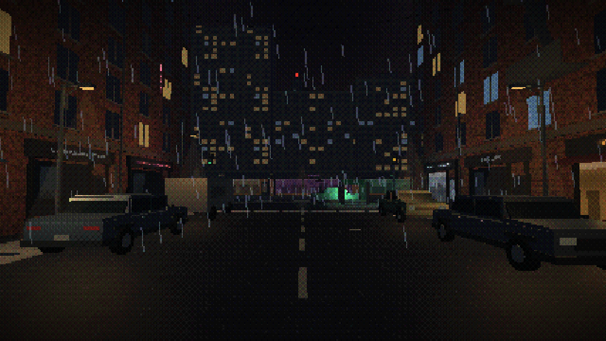
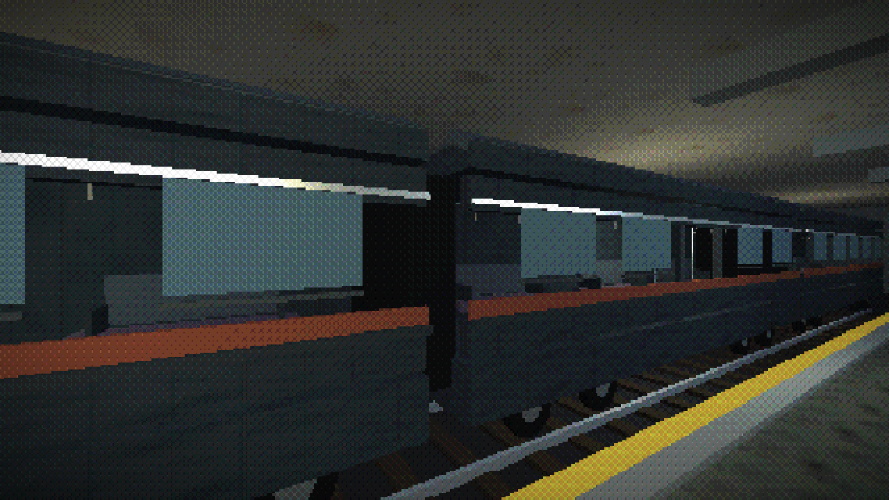

# NOIR — "Transit"

*A man returns, one year later, to search a rain-soaked apartment building for his missing wife — solving the puzzles of his own grief before the last train leaves without him.*

**[Run it locally](#running-locally)** — first-person psychological horror/mystery, browser-based, no install. PS2-era low-res rendering, entirely procedural sound, two endings.


## About

NOIR — Transit is a self-contained, first-person walking-mystery built in Three.js. Thomas Reed steps off the last train into Haldane Court, the apartment building where he and his wife Eileen once lived, one year after she disappeared. Over a single unbroken night he moves through the building and its memories — piecing together what happened through notes, photographs, and objects that outlasted the people who owned them — toward one of two endings.

The visual style is a deliberate throwback: a low-resolution render target, Bayer8 ordered dithering, and fog, in the spirit of *Silent Hill 2*, which the project used throughout as a direct visual and sound-design reference. There are no audio files — every sound (rain, drones, footsteps, dial tones, chimes, thunder, pipe drips, elevator motors, distant piano, PA announcements, heartbeats) is synthesized in code with the WebAudio API.

### Features

- **An opening ride-in** — the game begins seated on the last train, looking over an empty carriage as the tunnel goes by; the train pulls into the station, the doors open, and control starts in the doorway. `E` skips it.
- **11 connected zones** — an arrival station, the street, two dream-corridor interludes, the 8th floor (two flats), the ground-floor lobby, the back alley, a restock room, the 21st floor, the roof terrace, and the metro platform — linked by travel triggers, an elevator, and stairwells.
- **Per-pixel lit, low-res rendering** — every fixture in the world (tubes, sconces, street lamps, the generator's pilot light) casts a real pool of light, quantised and dithered down to 240 lines.
- **A fully procedural soundscape** — every ambient and story sound is synthesized, not sampled, with a per-zone weighted scheduler so each space has its own character.
- **Puzzles that are part of the story**, not obstacles bolted on: three hidden pages unlock a phone number, a four-chime music box only plays in the order the couple remembers it, a rooftop water tank has to be filled before it can be reached, and a four-piece key has to be assembled to open a safe.
- **Two distinct endings** reachable through different player choices — "THE DROP" on the terrace ledge, or "TRANSIT" on the metro platform.
- **Save/load via IndexedDB** — three manual slots plus autosave, each with a generated thumbnail, scene title, timestamp, and playtime.
- **A case-file themed landing page** merged into the same build, with a CONTINUE option that appears automatically once a save exists.

### Controls

`WASD` move · `Shift` run · mouse look · `E` interact · `F` flashlight · `Tab` journal · `Esc` pause/save.

On a touch screen the game builds its own controls on first touch: a stick bottom-left, drag anywhere on the picture to look, and `USE`, `LIGHT` and `JOURNAL` buttons. Landscape works best.

The pause menu has brightness, look-speed and volume sliders; they are remembered in the browser.

## Screenshots

| | |
|---|---|
|  |  |
| *The last train lets him out into a station the colour of an old bruise.* | *The 21st floor — numbered doors, and an umbrella left on a bench.* |
|  |  |
| *The terrace: a bench facing the city, and the string lights she hung.* | *The end of the street: the subway, and the rest of the city.* |
|  |  |
| *The train she has been waiting for.* | *The case-file landing page.* |

The in-game screenshots above are unretouched frames with the flashlight off and the HUD hidden.

## Why it's structured this way

This is the original single-file browser game (`noir-slice.html`) repackaged as a proper Next.js project so it can be deployed like any modern web app.

The game itself is a large, self-contained, imperative Three.js application — hundreds of functions and closures wired together with plain DOM `getElementById` lookups, not React state. Rewriting that into hundreds of React components would risk breaking the carefully debugged game logic for no real benefit. Instead:

- The game's original HTML markup and CSS are embedded as raw strings (not hand-converted to JSX) inside a client component, `app/game/NoirGame.jsx`, plus a small block of metro-zone HUD overrides.
- The game's ~3,100-line engine script lives at `public/game/engine.js` and is still a plain, framework-free script; it has been patched in place since the port.
- Three.js r128 is hosted locally at `public/game/three.min.js` (not loaded from a third-party CDN at runtime, so the deployed site doesn't depend on cdnjs staying up).
- On mount, the component injects the markup, then loads `three.min.js` and `engine.js` as ordinary `<script>` tags in order — exactly how the browser ran them in the original file.
- `app/page.js` dynamically imports the game with `ssr:false`, since the engine touches `window`/`document`/canvas/WebGL directly and was never written to run outside a browser.

This means all existing game features work unchanged: save/load via IndexedDB, both endings, every puzzle, all sound, the landing page.

## Running locally

```bash
npm install
npm run dev
```

Then open http://localhost:3000.

## Building for production

```bash
npm install
npm run build
```

This produces a fully static export in `out/` (configured via `output: "export"` in `next.config.mjs`) — no Node.js server is required to serve it.

You can preview the static build with any static file server, e.g.:

```bash
npx serve out
```

## Testing

```bash
npm run build
```

```bash
npm run test:smoke
```

The smoke test serves `out/`, boots the game in headless Chromium and plays it through the engine's own functions. It covers the whole game: the first half in order (arrival, dream, phone, the dial puzzle, the chase, the box room, the terrace) to ending A; then a fresh session for the terrace puzzles and their escalating hints, the ending B route to its end screen, pause, in-game load, and three saves taken mid-beat that used to soft-lock. It needs a Chromium for Playwright:

```bash
npx playwright install chromium
```

GitHub Actions runs the build and this test on every pull request (`.github/workflows/ci.yml`).

## Deploying

Because the build is a static export, you can deploy `out/` to essentially any static host:

- **Vercel**: `vercel deploy` from the project root (Vercel auto-detects Next.js and runs `next build` for you — you don't need to run the build yourself first).
- **Netlify**: drag-and-drop the `out/` folder in the Netlify dashboard, or connect the repo and set the build command to `npm run build` and the publish directory to `out`.
- **GitHub Pages / S3 / Cloudflare Pages / any static host**: upload the contents of `out/` directly.

If the site is served from a subpath rather than the domain root (a GitHub Pages project site, for example), build with the base path set so asset URLs are prefixed:

```bash
NEXT_PUBLIC_BASE_PATH=/Noir-Transit npm run build
```

## Notes

- `reactStrictMode` is disabled in `next.config.mjs`. The game engine is a singleton WebGL app with no teardown path (it was never written to be mounted/unmounted), so React's Strict Mode double-invoking effects in development would boot it twice. A boot guard in `NoirGame.jsx` also protects against this directly.
- Save data uses IndexedDB in the browser and is per-origin, same as the original file. Saving is disabled during dream sequences, and loading a slot from inside a running game restarts the page and resumes into that slot.
- The pause menu freezes the simulation, scripted timers and audio.
- Lighting: all surfaces are authored as `MeshLambertMaterial`, which `engine.js` routes to a matte per-pixel material at startup (walls and floors are single quads, so vertex lighting could not show a light pool). `wetMat()` adds a specular sheen to rain-slick ground. Per-level lights and dressing live in the `ART PASS` section near the end of the zone builds.
- The flashlight casts hard-edged shadows and is held at the hip rather than the eye, so they are visible. Doors swing (and lift doors part) under the fade when you travel through them.
- Point lights are bounded to rooms: each can carry an x/z box (`LIGHT_ROOMS`), and the shader drops its contribution outside it, so a lamp in the corridor cannot light the flat behind the wall. Outdoor levels share one sky, weather and city-sound system (`mkSky`, `nightlifeTick`).
- The camera holds its horizontal field of view (about 92°) and narrows vertically on wide windows, so rooms keep their scale.
- Puzzle hints escalate: the valve and chime puzzles only state their answer after four failed attempts; before that they point at the notes that carry it.
- The developer debug menu (teleports, noclip, puzzle skips) opens with `` ` `` or `F2`. Its on-screen button only appears with `?debug` in the URL.
- The picture is always 240 lines tall; the column count follows the window (320 at 4:3, 426 at 16:9, capped at 21:9) so pixels stay square.
- Art: `public/art/` holds six AI-generated images (landing hero, social card, two ending backdrops, the polaroid and the MISSING flyer, which `paintArt()` in `engine.js` paints onto the in-game textures), plus the favicons. They were generated with Higgsfield (GPT Image 2.6). Every use has a procedural fallback, so the game runs if a file is missing. Set `NEXT_PUBLIC_SITE_URL` at build time to make the social-card URL absolute.
- To modify game logic, edit `public/game/engine.js` directly — it's the same script that was in the original `<script>` tag, so all existing documentation/notes about the game's internals still apply.

## License

Released under the [MIT License](LICENSE).
