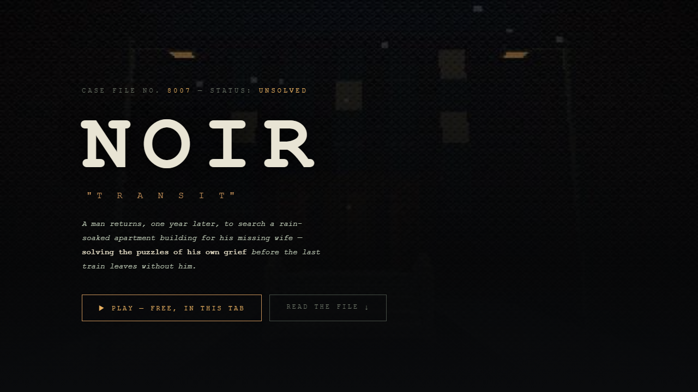
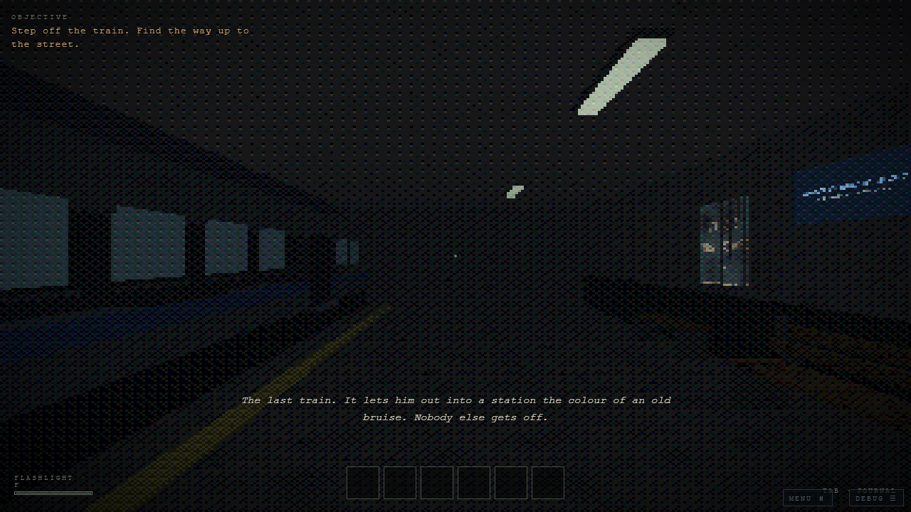
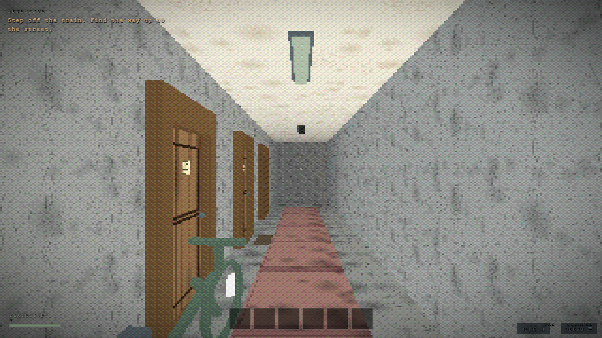
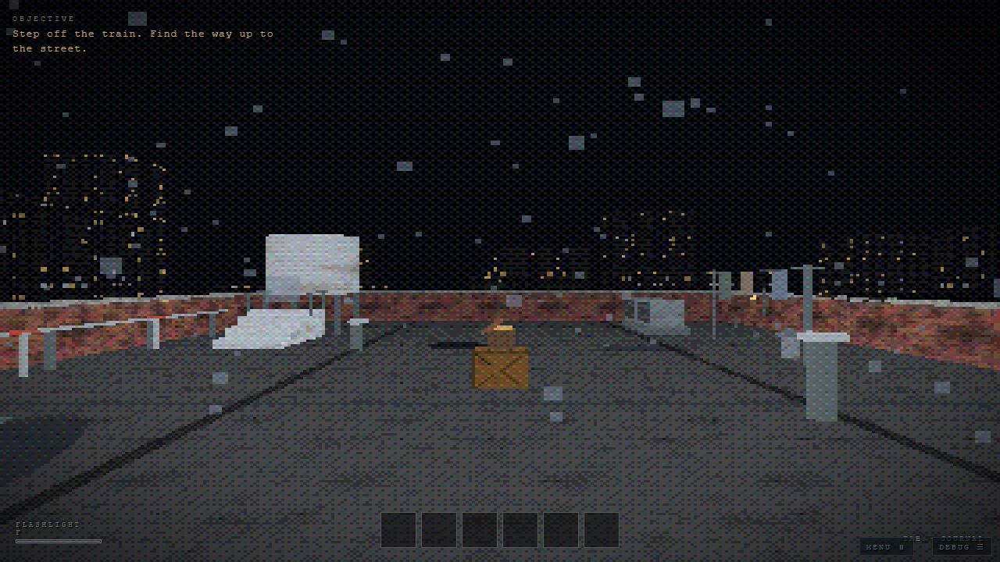

# NOIR — "Transit"

*A man returns, one year later, to search a rain-soaked apartment building for his missing wife — solving the puzzles of his own grief before the last train leaves without him.*

**[▶ Play it now](#running-locally)** — first-person psychological horror/mystery, browser-based, no install. PS2-era low-res rendering, entirely procedural sound, two endings.



## About

NOIR — Transit is a self-contained, first-person walking-mystery built in Three.js. Thomas Reed steps off the last train into Haldane Court, the apartment building where he and his wife Eileen once lived, one year after she disappeared. Over a single unbroken night he moves through the building and its memories — piecing together what happened through notes, photographs, and objects that outlasted the people who owned them — toward one of two endings.

The visual style is a deliberate throwback: a low-resolution render target, Bayer8 ordered dithering, and fog, in the spirit of *Silent Hill 2*, which the project used throughout as a direct visual and sound-design reference. There are no audio files — every sound (rain, drones, footsteps, dial tones, chimes, thunder, pipe drips, elevator motors, distant piano, PA announcements, heartbeats) is synthesized in code with the WebAudio API.

### Features

- **11 connected zones** — an arrival station, the street, two dream-corridor interludes, the 8th floor (two flats), the ground-floor lobby, the back alley, a restock room, the 21st floor, the roof terrace, and the metro platform — linked by travel triggers, an elevator, and stairwells.
- **A fully procedural soundscape** — every ambient and story sound is synthesized, not sampled, with a per-zone weighted scheduler so each space has its own character.
- **Puzzles that are part of the story**, not obstacles bolted on: three hidden pages unlock a phone number, a four-chime music box only plays in the order the couple remembers it, a rooftop water tank has to be filled before it can be reached, and a four-piece key has to be assembled to open a safe.
- **Two distinct endings** reachable through different player choices — "THE DROP" on the terrace ledge, or "TRANSIT" on the metro platform.
- **Save/load via IndexedDB** — three manual slots plus autosave, each with a generated thumbnail, scene title, timestamp, and playtime.
- **A case-file themed landing page** merged into the same build, with a CONTINUE option that appears automatically once a save exists.

### Controls

`WASD` move · mouse look · `E` interact · `F` flashlight · `Tab` journal · `Esc` pause/save. Desktop with a mouse is required — there's no touch control scheme yet.

## Screenshots

| | |
|---|---|
|  |  |
| *The last train lets him out into a station the colour of an old bruise.* | *The 21st floor — numbered doors, and an umbrella left on a bench.* |
|  |  |
| *The terrace, cleared of rain, as if someone kept it swept.* | *The case-file landing page.* |

## Why it's structured this way

This is the original single-file browser game (`noir-slice.html`) repackaged as a proper Next.js project so it can be deployed like any modern web app.

The game itself is a large, self-contained, imperative Three.js application — hundreds of functions and closures wired together with plain DOM `getElementById` lookups, not React state. Rewriting that into hundreds of React components would risk breaking the carefully debugged game logic for no real benefit. Instead:

- The game's original HTML markup and CSS are embedded verbatim (byte-for-byte identical to the source file) inside a client component, `app/game/NoirGame.jsx`.
- The game's ~2,900-line engine script lives untouched at `public/game/engine.js`.
- Three.js r128 is hosted locally at `public/game/three.min.js` (not loaded from a third-party CDN at runtime, so the deployed site doesn't depend on cdnjs staying up).
- On mount, the component injects the markup, then loads `three.min.js` and `engine.js` as ordinary `<script>` tags in order — exactly how the browser ran them in the original file.
- `app/page.js` dynamically imports the game with `ssr:false`, since the engine touches `window`/`document`/canvas/WebGL directly and was never written to run outside a browser.

This means all existing game features work unchanged: save/load via IndexedDB, both endings, every puzzle, all sound, the landing page.

## Running locally

```bash
npm install
npm run dev
```

Then open http://localhost:3000.

## Building for production

```bash
npm install
npm run build
```

This produces a fully static export in `out/` (configured via `output: "export"` in `next.config.mjs`) — no Node.js server is required to serve it.

You can preview the static build with any static file server, e.g.:

```bash
npx serve out
```

## Deploying

Because the build is a static export, you can deploy `out/` to essentially any static host:

- **Vercel**: `vercel deploy` from the project root (Vercel auto-detects Next.js and runs `next build` for you — you don't need to run the build yourself first).
- **Netlify**: drag-and-drop the `out/` folder in the Netlify dashboard, or connect the repo and set the build command to `npm run build` and the publish directory to `out`.
- **GitHub Pages / S3 / Cloudflare Pages / any static host**: upload the contents of `out/` directly.

## Notes

- `reactStrictMode` is disabled in `next.config.mjs`. The game engine is a singleton WebGL app with no teardown path (it was never written to be mounted/unmounted), so React's Strict Mode double-invoking effects in development would boot it twice. A boot guard in `NoirGame.jsx` also protects against this directly.
- Save data uses IndexedDB in the browser and is per-origin, same as the original file.
- To modify game logic, edit `public/game/engine.js` directly — it's the same script that was in the original `<script>` tag, so all existing documentation/notes about the game's internals still apply.

## License

Released under the [MIT License](LICENSE).
